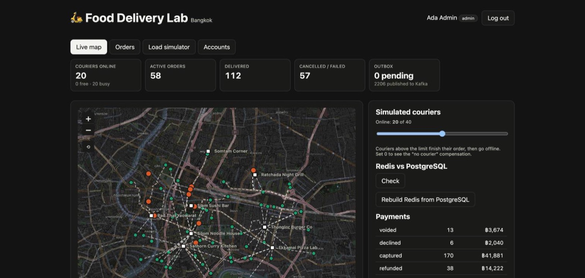
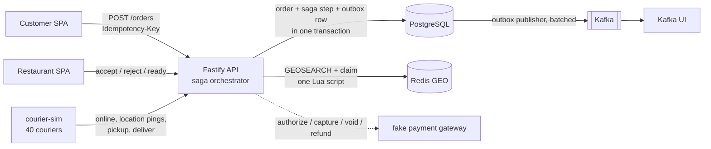
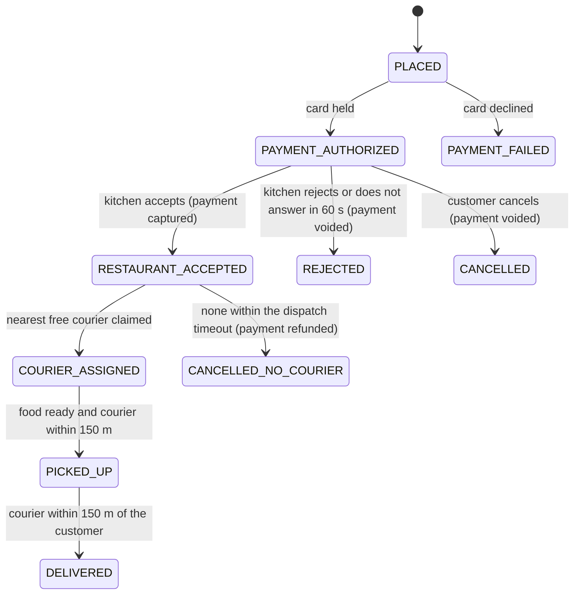
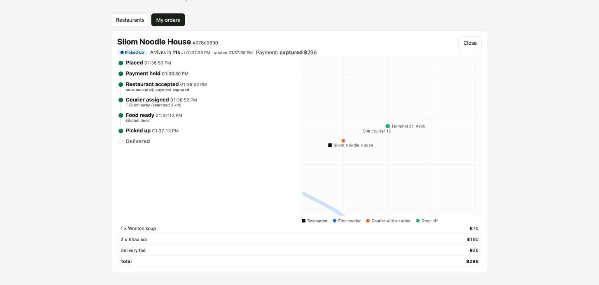
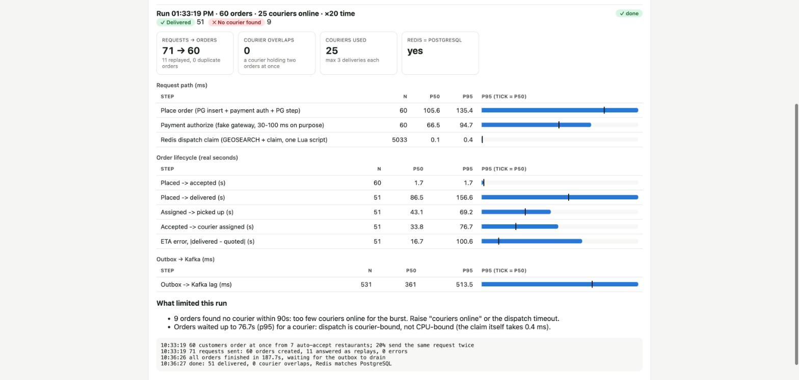

# Food Delivery Lab

[](https://github.com/allimist/food-delivery-lab/actions/workflows/ci.yml)


[](LICENSE)



A hands-on learning project that rebuilds the core of a food delivery app (think DoorDash / Grab Food / LINE MAN) for central **Bangkok**. It is small enough to read in an afternoon but keeps the hard parts:

- an **order saga** across payment, restaurant and courier, with **compensating steps** when one of them fails
- **courier dispatch** with Redis GEO and one atomic Lua claim, so a courier never gets two orders
- the **transactional outbox** into Kafka
- **idempotent checkout** (a double click makes one order)
- an **ETA** that learns each kitchen's real prep time
- a **load simulator** with 40 simulated couriers riding through the public API, which shows where the time goes
- a **live map** on real Bangkok streets (Leaflet + OpenStreetMap tiles, no API key): zoom from the whole region down to a street, and the order tracker follows its courier and draws its route: ridden so far in dark green, still to ride in light green
- **street routing**: couriers ride real roads, using A* over 13k junctions of Bangkok's main roads taken from OpenStreetMap and shipped with the API (180 KB). The ETA uses road distance, not distance as the crow flies

It is the sister project of [hotel-booking-lab](https://github.com/allimist/hotel-booking-lab) and [flight-booking-lab](https://github.com/allimist/flight-booking-lab), with the same stack and conventions. Everything runs locally with Docker Compose or Podman Compose. Nothing is production-ready on purpose: passwords are plain text and shown on the login page so anyone can try every role.

## Run it

```bash
docker compose up -d --build        # or: podman compose up -d --build
open http://localhost:5175          # web (port taken? WEB_PORT=5185 docker compose up -d)
./scripts/smoke.sh                  # end-to-end test of every saga path
(cd apps/api && npm test)           # unit tests for street routing
```

| Service | Address | Used for |
|---|---|---|
| Web | http://localhost:5175 | customer, restaurant, courier and admin screens |
| API | http://localhost:3030/api | REST + JWT, saga orchestrator, dispatch, outbox publisher, simulator |
| Kafka UI | http://localhost:8082 | topics `orders.events`, `payments.events`, `couriers.events` |
| PostgreSQL | localhost:5436 (user/db/password `food`) | source of truth |
| Redis | localhost:6381 | courier positions, free-courier set, prep-time averages |

Ports are offset from the other labs, so all of them can run side by side. The map loads its tiles from OpenStreetMap, so it needs internet; everything else runs offline.

**Time runs 20× faster** (`TIME_SCALE`): a 15-minute prep takes 45 seconds and a courier at 25 km/h crosses 3 km in about 22 seconds. One order goes from checkout to the door in about a minute.

| Log in as | Email / password | Try |
|---|---|---|
| Customer | `customer@example.com` / `customer123` | order, watch the tracker, press **Place twice at once** |
| Restaurant (by hand) | `restaurant@example.com` / `restaurant123` | Somtam Corner: accept, reject or let it time out, mark food ready |
| Restaurant (auto) | `restaurant2@example.com` / `restaurant123` | Pad Thai Yaowarat: the kitchen timer does it |
| Courier | `courier@example.com` / `courier123` | go online, ride, pick up, deliver (set the sim couriers to 0 first) |
| Admin | `admin@example.com` / `admin123` | live map, courier slider, consistency check, simulator, act as anyone |

## Architecture



### The saga



- **One orchestrator, conditional steps.** Every step is `UPDATE orders SET status=… WHERE id=… AND status = <expected>`, plus a row in the saga log and an outbox event, all in one transaction. If two workers race for the same step, or a restaurant click races the timeout, exactly one wins. That is also why several API replicas could run the saga loop side by side.
- **Compensation follows money.** The card is *authorized* at checkout, *captured* when the kitchen commits, *voided* if the kitchen says no, and *refunded* if no courier comes. The tracker shows the compensation next to the failed step.
- **The gateway is called outside the transaction**, with the order id as its idempotency key (`UNIQUE(order_id)` on `payments`). A crash between "order inserted" and "card authorized" leaves the order in `PLACED`, and the loop retries it without charging twice.

### Dispatch: Redis decides fast, PostgreSQL decides last

```
couriers:pos      GEO set   last position of every courier
couriers:free     GEO set   online and carrying nothing; the only set dispatch searches
courier:order:ID  string    the order a courier carries
order:trail:ID    list      where the courier has been while carrying the order (for the map only)
order:plan:ID     string    the streets it will take to the restaurant and to the customer (JSON)
```

- **Claim** is one Lua script: `GEOSEARCH couriers:free … ASC COUNT 1`, `ZREM` the courier, set its order key. Two orders racing for the same courier run one after the other; the second no longer finds it.
- **Position pings are a Lua script too.** The courier goes back into `couriers:free` only if it is online *and* has no order key. A plain "read state, then GEOADD" would let a ping that read "free" just before a claim put the courier back, and the courier would get a second order.
- **The search widens while an order waits**: 3 km, then 6 km after 10 s, then 12 km after 20 s.
- **PostgreSQL has the final say.** A partial unique index `one_active_order_per_courier ON orders(courier_id) WHERE status IN ('COURIER_ASSIGNED','PICKED_UP')` refuses a second active order. If Redis were ever wrong, the step fails and the claim is undone.
- **Couriers ride the streets.** When a courier is assigned, the API plans its ride along the roads (`roads.ts`, A* over OpenStreetMap main roads): to the restaurant, then to the customer. The courier app follows that plan and, with each ping, sends the corners it turned since the last one, so the trail follows the streets too. A door off the main roads is reached in a straight line from the nearest point on a road. One-way streets are ignored (it's a scooter). `node scripts/build-roads.mjs` rebuilds the road file from OpenStreetMap.
- **Redis can be rebuilt.** On start (and from the admin button) the API makes Redis agree with PostgreSQL about who carries what. The admin's consistency check compares the two.

### ETA that learns

ETA = max(prep time left, courier's ride to the restaurant) + ride to the customer. Prep time is a per-restaurant **exponentially weighted average** (α = 0.2, one Lua script) of real prep times. It starts from the menu's estimate and moves as kitchens mark food ready, which the restaurant list shows ("Prep ≈ 13.2 min, learned, started at 12"). The ETA quoted at checkout is stored, so the simulator can measure how wrong it was.

### Outbox → Kafka

Same pattern as the other labs: events are rows in `outbox_events`, written in the step's transaction, so an order can never change without its event or the other way round. A publisher sends them; Kafka being down never blocks an order. Two changes from the flight lab, which found one send per event to be its bottleneck: one poll sends **one batch** (up to 500 rows), and every event is keyed by **order id**, so all events of one order land on one partition in order. Courier location pings go to Redis only, not to PostgreSQL or Kafka.

## Screenshots

| Order tracker | Load simulator report |
|---|---|
|  |  |

## Measured

60 customers ordering at the same instant (20% of them sending the request twice), 25 couriers online, ×20 time, on a laptop with Podman (2 GB VM):

| Step | p50 | p95 |
|---|---|---|
| Place order (insert + payment authorize + step) | 106 ms | 135 ms |
| … of which the fake gateway (30-100 ms on purpose) | 67 ms | 95 ms |
| Redis dispatch claim (GEOSEARCH + claim, Lua), 5,033 claims | 0.1 ms | 0.4 ms |
| Placed → restaurant accepted | 1.7 s | 1.7 s |
| Accepted → courier assigned | 34 s | 77 s |
| Placed → delivered | 87 s (29 lab-min) | 157 s (52 lab-min) |
| \|Delivered − quoted ETA\| | 17 s | 101 s |
| Outbox → Kafka lag | 361 ms | 514 ms |

**Invariants:** 71 requests made 60 orders (11 answered as replays, 0 duplicates). 51 were delivered and 9 found no courier within 90 s and were refunded. No courier held two orders at once, and Redis matched PostgreSQL afterwards. A 120-order burst on 20 couriers gave the same invariants.

**What it shows:**

- **Couriers are the bottleneck, not the code.** A claim takes 0.4 ms, but orders waited up to 77 s for someone to be free.
- **The quoted ETA ignores the courier queue.** It is close for the first orders (17 s p50) and far off for the ones that waited (101 s p95). Feeding "orders waiting / couriers free" into the estimate is the obvious next step.

## Layout

```
apps/api/src/
  server.ts      routes and roles
  saga.ts        saga steps, compensations, fake gateway, ETA, saga loop, outbox publisher
  dispatch.ts    Redis keys and Lua scripts: claim, ping, release, prep-time average, reconcile, the courier's planned ride
  roads.ts       street routing: A* over the road network in apps/api/data/roads.json
  sim.ts         load simulator and the Redis/PostgreSQL consistency check
  ctx.ts         clients, settings, helpers
apps/courier-sim/src/worker.ts   40 couriers using the public API like a phone app would
apps/web/src/main.tsx            React SPA: customer, restaurant, courier, admin, Leaflet map on OpenStreetMap tiles
database/init.sql                schema + Bangkok seed (8 restaurants, 26 dishes, 52 accounts)
scripts/smoke.sh                 end-to-end test, run in CI
scripts/build-roads.mjs          downloads Bangkok's main roads from OpenStreetMap into apps/api/data/roads.json
```

## Not in scope (on purpose)

Real auth (passwords are plain text), a real payment provider, traffic and one-way streets in routing, side streets (only main roads are in the road file), batching two orders on one courier, surge pricing, multiple cities.

## License

MIT. The road data in `apps/api/data/roads.json` is © [OpenStreetMap contributors](https://www.openstreetmap.org/copyright), available under the ODbL.
